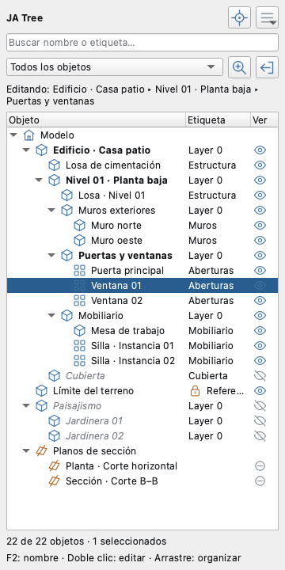
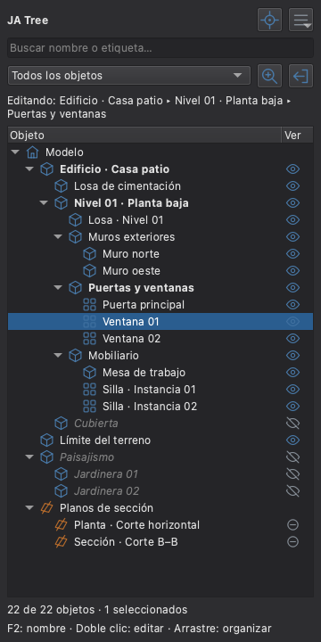

# JA Tree para IngeTrazo


[Descargar v0.1.0](https://github.com/wrc86/ja-tree-ingetrazo/releases/tag/v0.1.0) · [Manual ES/EN](MANUAL.md) · [Documentación](docs/Inicio.md) · [Reportar un problema](https://github.com/wrc86/ja-tree-ingetrazo/issues)

Repositorio independiente de **JA Tree**. Consulta las otras extensiones en el [catálogo de Julio Angulo](https://github.com/wrc86/ja-ingetrazo-extensions).


**0.1.0 · Julio Angulo · IngeTrazo 0.5.7 / API de extensiones 2**

Explorador de la jerarquía del modelo para explorar y organizar
los grupos, componentes y planos de sección del modelo. Usa objetos nativos de
IngeTrazo, su historial y su formato IGZ. La jerarquía sigue funcionando aunque
se retire el plugin.

## Instalación

1. Descomprime **JA_Tree_v0.1.0.zip**.
2. En IngeTrazo abre **Extensiones → Abrir carpeta de plugins**.
3. Copia allí la carpeta **outliner completa**, incluidos sus iconos. Se conserva
   este identificador interno para actualizar la instalación anterior y sus preferencias.
4. Reinicia IngeTrazo.
5. Abre **Extensiones → JA Tree…** o **Ctrl+Alt+O**, si el atajo está libre.
   En macOS Qt muestra Ctrl como Command. También aparece en **Ventana → Paneles**.

El ZIP incluye un **Ejemplo_JA_Tree.igz** con una casa organizada por niveles,
muros, aberturas, mobiliario, paisajismo y planos de sección. Guárdalo fuera de
la carpeta de plugins y ábrelo desde Archivo → Abrir para explorar el panel.
Los cortes del ejemplo empiezan desactivados.

Es un plugin Python para IngeTrazo. No se instala como un RBZ de SketchUp.
No requiere instalar dependencias adicionales.

```text
plugins/
└── outliner/
    ├── __init__.py
    ├── controller.py
    ├── model.py
    ├── ui.py
    └── icons/
```

## Idiomas

La interfaz incluye **español, inglés y francés**, con menús, ayudas, mensajes,
errores y controles traducidos. En el botón de opciones del panel abre
**Idioma → Español / English / Français**. El cambio es inmediato y se conserva
como preferencia personal. **Automático (IngeTrazo)** sigue el idioma del programa;
para idiomas no incluidos utiliza inglés. El francés se puede elegir aquí aunque
IngeTrazo 0.5.7 no lo ofrezca en su menú de idiomas. Los nombres y etiquetas del
modelo se mantienen como los escribió el usuario.

Guías breves: [English](README_EN.md) · [Français](README_FR.md).

## Uso

- **Árbol:** flechas para expandir/contraer; iconos distintos para grupos,
  componentes y planos de sección. Los contenedores abiertos aparecen en negrita
  y su ruta se muestra sobre el árbol. Los objetos ocultos aparecen en cursiva.
- **Seleccionar:** clic en el nombre; Ctrl/Command o Mayús para selección múltiple
  dentro del mismo contenedor. Elegir un hijo abre sus antecesores con la edición
  nativa para que las herramientas actúen en el contexto correcto. La selección
  de la vista 3D también se refleja en el árbol.
- **Editar:** doble clic o Intro abre el grupo/componente. Esc o el botón de salir
  retrocede un nivel. La edición geométrica de componentes conserva el
  comportamiento compartido nativo del anfitrión.
- **Renombrar:** F2 o clic derecho → Renombrar, escribe y pulsa Intro.
- **Buscar:** nombre, etiqueta o símbolo del corte, sin distinguir mayúsculas
  ni acentos. Los antecesores de las coincidencias permanecen visibles. El filtro
  permite mostrar grupos, componentes o planos de sección.
- **Visibilidad:** clic en el ojo oculta/muestra el objeto y sus descendientes.
  Clic derecho → Ocultar/Mostrar opera sobre varios objetos. Un hijo cuyo padre
  o etiqueta esté oculto seguirá invisible al quitar su ocultamiento individual;
  el panel lo explica. Las filas ocultas pueden seleccionarse para gestionarlas
  sin añadir objetos invisibles a la selección de la vista 3D.
- **Encuadrar:** botón de lupa, F o clic derecho → Encuadrar. Calcula los límites
  en coordenadas globales, también para objetos anidados.
- **Localizar:** botón de mira o clic derecho en la vista 3D → Localizar en JA Tree
  quita los filtros y revela la selección.
- **Organizar:** arrastra un grupo/componente sobre otro para anidarlo. Arrastra
  sobre **Modelo** o usa **Mover al nivel del modelo** para sacarlo al nivel raíz.
  Arrastra entre hermanos para cambiar su orden. El menú de opciones permite
  ordenar por nombre con orden natural: «Elemento 2» antes de «Elemento 10».
  Desactiva A–Z para reordenar manualmente entre hermanos.
- **Etiquetas:** clic derecho → Asignar etiqueta utiliza las etiquetas existentes.
  El candado indica bloqueo por la etiqueta del objeto o de un antecesor.
  Las etiquetas se ocultan automáticamente cuando el panel mide menos de 330 px;
  el menú de opciones permite ocultarlas también en paneles más anchos.
- **Cortes:** aparecen en la sección Planos de sección. Clic en su indicador
  activa/desactiva el corte; solo uno puede estar activo. Admiten selección,
  renombrado y eliminación. No se anidan porque el anfitrión los guarda en el
  contexto global del modelo.
- **Eliminar:** clic derecho → Eliminar. Elimina los objetos seleccionados y
  conserva un solo paso de Deshacer para el lote.

## Guardado, deshacer y compatibilidad

Renombrar, ocultar, asignar etiquetas, reorganizar, activar cortes y eliminar
utilizan el historial nativo. Guarda el modelo como **IGZ** para conservar la
jerarquía, nombres, etiquetas y visibilidades. Las preferencias de orden y de
columna de etiquetas se guardan en las preferencias personales de la aplicación.

Mover entre contenedores conserva las posiciones globales, incluso con rotación,
escala y reflexión. Mantiene las mallas compartidas, materiales, identificadores
y metadatos de otros plugins. Deshacer la organización cierra el contexto abierto
y restaura los marcos originales sin copiar la geometría. La reestructuración
afecta las instancias elegidas; no reestructura automáticamente otras copias del
componente. Renombrar cambia el nombre de la instancia nativa, no el nombre de
una definición compartida como en SketchUp.

IngeTrazo 0.5.7 tiene bloqueo por etiqueta, sin un candado individual nativo para
grupos. El panel respeta ese bloqueo al seleccionar, editar, mover o eliminar.
Desbloquea la etiqueta desde el panel nativo de etiquetas. No permite ciclos,
destinos con escala nula ni reorganizar una vista explotada sin reensamblarla.
Muestra contenedores y cortes; las caras y aristas sueltas se agrupan con las
herramientas nativas para aparecer en el árbol.

El panel sigue el tema claro/oscuro y puede convivir con JA Toggle Units,
Línea Cámara y Escenas y Líneas de colores. No modifica archivos del programa.
Comprobado con el código real de **IngeTrazo 0.5.7**, commit **6be29fe**. La API
0.x es provisional; otras versiones necesitan comprobar compatibilidad.
Las pruebas de desarrollo no equivalen a probarlo en el binario instalado.

Para desinstalar, cierra IngeTrazo y retira la carpeta outliner de plugins.

## Desarrollo y verificación

En el entorno de desarrollo original (los scripts y pruebas citados no están incluidos en este repositorio):

```sh
dev-env/bin/python -m pytest tests/test_outliner.py -q
dev-env/bin/python scripts/preview_outliner.py
dev-env/bin/python scripts/build_outliner_release.py
```

Las pruebas usan el descubridor de plugins, MainWindow, Qt, el historial y el
codec IGZ reales. Cubren selección y edición anidada, controles con eventos de
ratón y teclado, búsqueda, visibilidad heredada, transformaciones, componentes
compartidos, rechazo de ciclos, deshacer/rehacer tras entrar en contenedores,
cortes, temas, panel estrecho y convivencia con las extensiones existentes.

Referencias:

- [Outliner de SketchUp](https://help.sketchup.com/en/sketchup/working-hierarchies-outliner)
- [API de extensiones de IngeTrazo](https://github.com/ingelibre/ingetrazo/blob/6be29fe/docs/plugins.md)
- [Grupos y componentes nativos](https://github.com/ingelibre/ingetrazo/blob/6be29fe/core/group.py)
- [Historial nativo](https://github.com/ingelibre/ingetrazo/blob/6be29fe/core/history.py)

## Código abierto

JA Tree **0.1.0** es la primera versión preparada para publicación. Se distribuye
bajo **GPL-3.0-or-later**: [licencia](LICENSE), [autoría y dependencias](NOTICES.md),
[contribuir y reproducir las pruebas](CONTRIBUTING.md) y [cambios](CHANGELOG.md).
Se incluye un ZIP instalable y otro con el código fuente y sus pruebas.

## Galería




